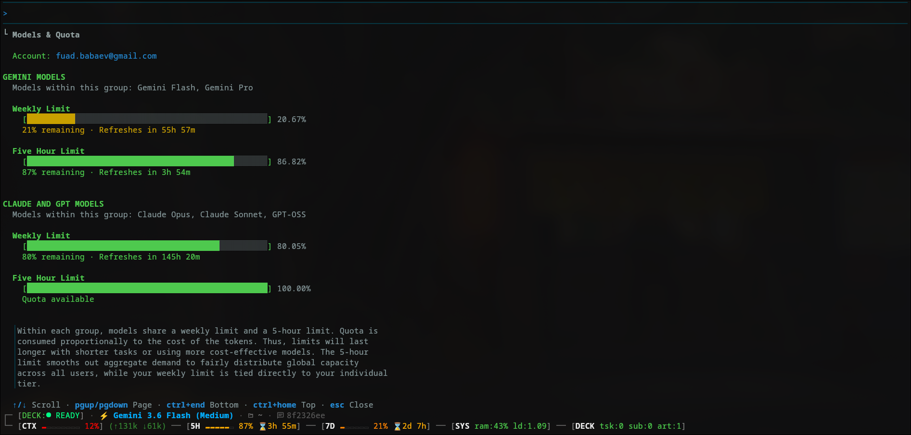

# ⚡ Neuromancer

> **High-Density Cyberpunk Onyx Telemetry Deck & Statusline for Antigravity CLI**



**Neuromancer** upgrades your `antigravity-cli` statusline into a high-density, crash-proof **Onyx Deck HUD** equipped with dynamic Cyberpunk Amber indicator gauges, fail-safe Python execution, and accurate dual-quota refresh timers.

---

## 🔥 Features

- **⚡ Fail-Safe Python Engine:** Written in pure Python 3 with `try/except` guards. Zero terminal crashes from missing JSON attributes, null fields, or shell pipeline errors.
- **▰▰▰ Cyberpunk Amber Gauges:** Dynamic 3-tier Amber indicator bars for Context Window usage and Model Quotas (`5H` and `7D`).
- **⌛ Accurate Dual-Quota Timers:** Correctly tracks both your short-term 5-hour rolling rate limit (**`5H`**) and your weekly quota cycle (**`7D`**) independently.
- **🖥️ Onyx Deck Framework:** Clean 2-row layout (`┌─` / `└─`), Matrix Cyan accents, dirty Git indicators, and real-time CPU load & RAM diagnostics.
- **🚀 1-Step Installation:** Auto-configures `~/.gemini/antigravity-cli/settings.json`.

---

## 💻 Installation

Run this single command in your terminal:

```bash
curl -fsSL https://raw.githubusercontent.com/YOUR_USERNAME/neuromancer/main/install.sh | bash
```

Or install manually:

```bash
git clone https://github.com/YOUR_USERNAME/neuromancer.git
cd neuromancer
chmod +x install.sh && ./install.sh
```

---

## 🎨 Color Palette & Gauge Indicators

| Indicator | Remaining % | Color Theme |
| :--- | :--- | :--- |
| **High Quota / Low Ctx** | `> 50%` | **Bright Cyber Amber** (`#ffb000` / ANSI 214) |
| **Medium Quota / Ctx** | `20% – 50%` | **Warm Amber-Orange** (`#ff8700` / ANSI 208) |
| **Critical Quota / Ctx** | `< 20%` | **Crimson Alert** (`#ff0055` / ANSI 197) |
| **Empty Gauge Shadow** | `0%` | **Deep Slate Shadow** (`#3a3d4a` / ANSI 238) |

---

## 📄 License

MIT © Fuad Babaev
